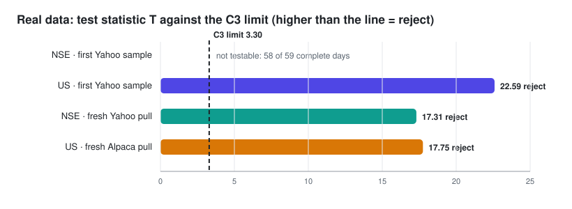
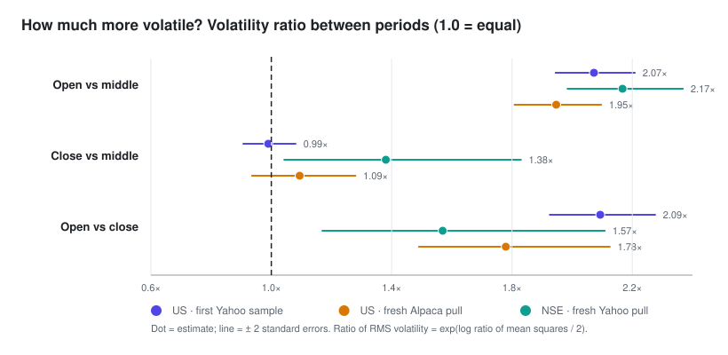
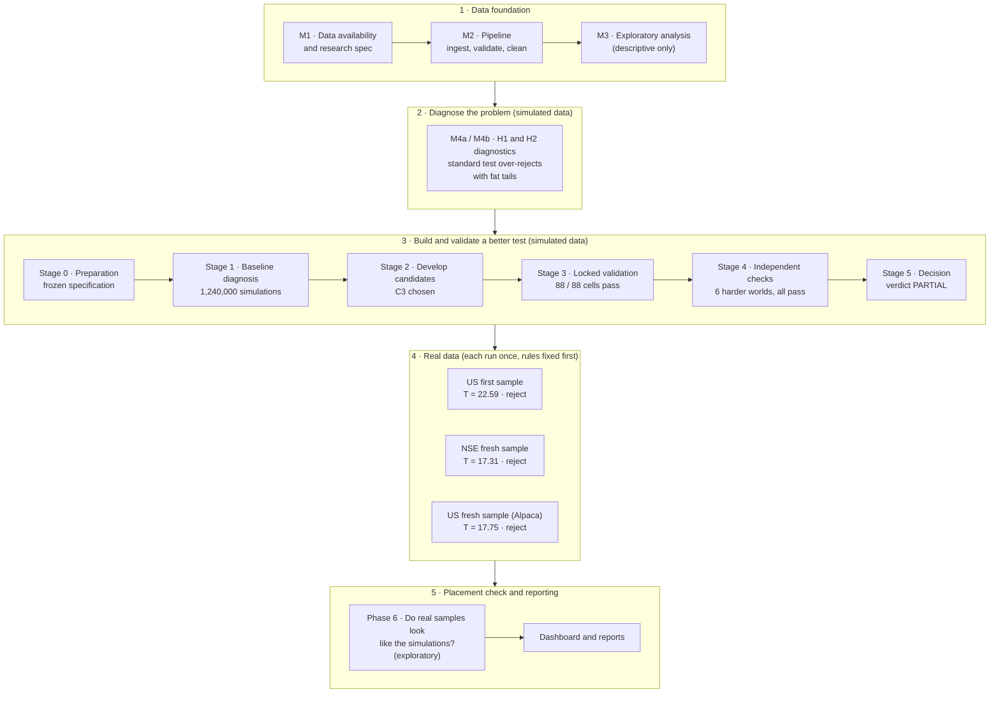
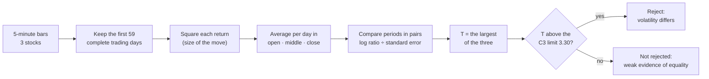
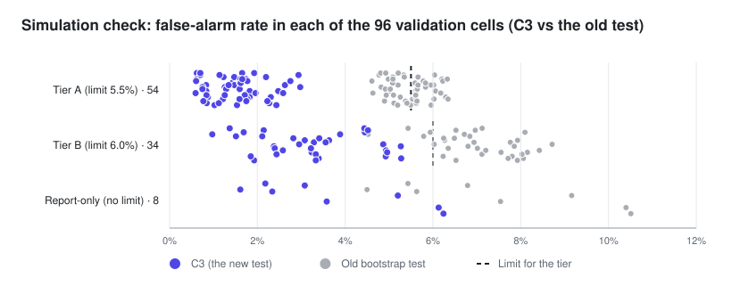
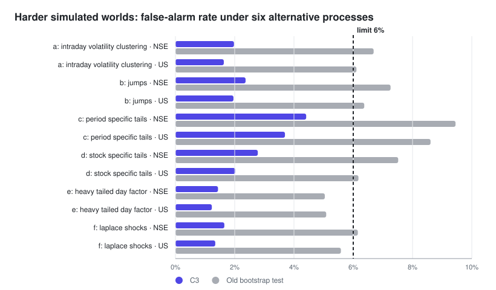
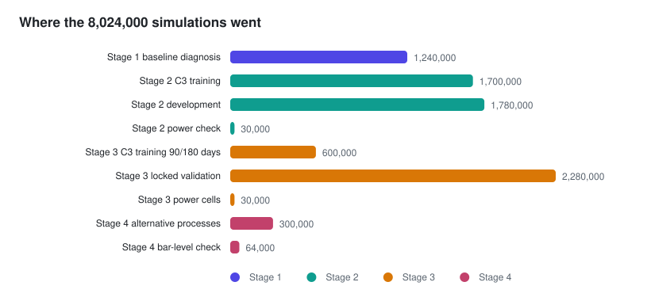
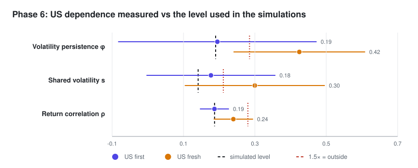
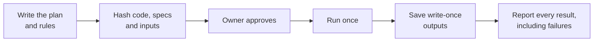

# QuantLab

**A research project that asks one question carefully: is a stock's volatility the same at the open, the middle and the close of the trading day?**

It works on 5-minute price bars for three Indian (NSE) and three US stocks. Most of the effort went into **building a test you can trust** on short, fat-tailed samples, checking that test on millions of simulated markets, and only then running it on real data, once per sample, with every rule fixed in advance.

> QuantLab is a research tool. It makes **no profitability claims** and contains no trading strategy or backtest.

| | |
|---|---|
| **Stocks** | NSE: `RELIANCE.NS`, `TCS.NS`, `INFY.NS` · US: `AAPL`, `MSFT`, `NVDA` |
| **Data** | 5-minute OHLCV bars from Yahoo Finance and the Alpaca Market Data API (free tiers) |
| **Simulations run** | **8,024,000** (H1 calibration Stages 1–4) |
| **Answer** | In all **3 of 3** testable real samples, volatility is **not** equal: the open is about **2× as volatile** as the middle of the day |
| **Test verdict** | The new test (C3) is **PARTIAL**: safe in every simulated scenario with a pass limit, but not proven exactly right on real data |
| **Tests and integrity** | 413 automated tests pass · 13 hash manifests freeze every input · ₹0 spent |
| **Live dashboard** | [QuantLab H1 Results](https://claude.ai/artifact/JyiVESsrnCvSjoXpwpdARw) (offline copy: [`dashboard/index.html`](dashboard/index.html)) |

---

## Contents
1. [The question in plain words](#1-the-question-in-plain-words)
2. [Results at a glance](#2-results-at-a-glance)
3. [The whole project in one flowchart](#3-the-whole-project-in-one-flowchart)
4. [Every phase: what it did and why it matters](#4-every-phase-what-it-did-and-why-it-matters)
5. [How the H1 test works](#5-how-the-h1-test-works)
6. [More charts](#6-more-charts)
7. [Data sources](#7-data-sources)
8. [Trust and reproducibility](#8-trust-and-reproducibility)
9. [What the results do not show](#9-what-the-results-do-not-show)
10. [Run it yourself](#10-run-it-yourself)
11. [Repository map and document index](#11-repository-map-and-document-index)
12. [Tech stack](#12-tech-stack)
13. [Glossary](#13-glossary)

---

## 1. The question in plain words

Traders often say markets are "busiest" at the open and the close. QuantLab splits each trading day into three periods (**open**, **middle**, **close**) and asks whether the size of 5-minute price moves is the same in all three. This is called **H1**.

Asking is easy; answering honestly is hard:

- **Short samples.** Free data gives only about 59 trading days of 5-minute bars.
- **Fat tails.** Big surprise moves happen far more often than a bell curve predicts.
- **Uneven shapes.** Volatility changes bar by bar *inside* each period.

Under these conditions the standard bootstrap test said "different!" too often (7–9% of the time instead of 5%). So before touching real data, the project **built and validated a better test** (C3) on simulated markets where the true answer is known.

| Research question | State |
|---|---|
| **H1** volatility across open, middle and close | **Answered for the approved scope**: real data rejects equal volatility in 3 of 3 testable samples |
| H2 does volume carry predictive information (not causal) | Diagnostic and power work on simulated data only; no real-market test |
| H3 serial dependence | Paused |

---

## 2. Results at a glance

### Real data: every testable sample rejects "equal volatility"



The test statistic **T** is far above the C3 limit (3.30) in all three testable samples, so equal volatility is rejected. One NSE sample had only 58 of the required 59 complete days, so it was reported as **not testable** instead of being quietly shortened.

| Sample | Source | Days used | T | Result |
|---|---|---|---|---|
| US, first sample | Yahoo | 2026-08-06 to 2026-10-28 | 22.59 | Reject |
| US, fresh sample | Alpaca (SIP feed) | 2026-04-13 to 2026-07-07 | 17.75 | Reject |
| NSE, fresh sample | Yahoo | 2026-08-18 to 2026-11-13 | 17.31 | Reject |
| NSE, first sample | Yahoo | — | — | Not testable (58 of 59 days) |

### How big is the difference?



In every sample the **open is about 1.9–2.2× as volatile as the middle** of the day. The close is closer to the middle: about equal in the first US sample, and moderately higher in the others. This is a well-known market pattern, so the result **confirms** it rather than discovers it. What is new is that the test behind it has been checked carefully.

---

## 3. The whole project in one flowchart



---

## 4. Every phase: what it did and why it matters

Each phase was approved before it started, and each one's rules were written down (and usually hashed) **before** its results existed.

### Phase M1 · Data availability and research specification
- **What:** checked which free sources give 5-minute bars for the six stocks, and wrote the research specification (periods, slots, questions).
- **Why it matters:** decides what can honestly be studied. Free Yahoo data gives only about 60 days of 5-minute history, which sets the sample size (59 days) used everywhere after.
- **Docs:** [01](docs/01_data_availability_report.md), [02](docs/02_research_spec.md), [03](docs/03_data_sources_and_licensing.md)

### Phase M2 · Ingestion, validation and cleaning pipeline
- **What:** pulls raw data once into write-once files with SHA-256 hashes, then parses, validates (missing bars, duplicates, invalid prices, zero volume) and cleans it. Every bar keeps a status flag; nothing is silently filled or deleted.
- **Why it matters:** every later number rests on this. It also found an NSE feed quirk: the 15:15–15:25 bars were empty or unreliable in Yahoo data.
- **Docs:** [04](docs/04_nse_anomaly_investigation.md), [05](docs/05_validation_rules.md) · **Code:** `src/quantlab/` (calendars, ingest, parse, validate, clean)

### Phase M3 · Exploratory data analysis
- **What:** descriptive look at volatility by time of day, volume, tails and data quality.
- **Why it matters:** showed the shapes and fat tails that make H1 hard to test. It is descriptive only; nothing is claimed from it.
- **Docs:** [06](docs/06_eda_findings.md)

### Phase M4a / M4b · Diagnostics on simulated data
- **What:** simulated markets where the true answer is known, to see how H1 and H2 tests behave (814,880 simulation rows in M4b).
- **Why it matters:** this is where the **main problem was found**. The standard H1 bootstrap test rejected **7–9% of the time instead of 5%** when tails were heavy and intraday shapes uneven. Without this, a real-data "reject" could have been a false alarm.
- **Docs:** [09](docs/09_m4a_h1_h2_diagnostic_report.md), [10](docs/10_m4a_h1_method_comparison_and_h2_validation.md), [11](docs/11_m4a_next_diagnostic_round.md), [12](docs/12_m4b_h1_inference_and_h2_power_report.md)

### H1 calibration, Stages 0–5 · Build a test that can be trusted
| Stage | What it did | Why it matters | Docs |
|---|---|---|---|
| **0 · Preparation** | Benchmarks, precision arithmetic, frozen specification v1 (23 hashed files) and v1.1 | Fixes every rule before results exist, so nothing can be tuned to a desired answer | [13](docs/13_h1_calibration_investigation_plan.md), [14](docs/14_h1_calibration_stage0_report.md), [15](docs/15_h1_calibration_decision_document.md), [15a](docs/15a_h1_calibration_spec_v1_1.md), [15b](docs/15b_h1_calibration_v1_1_review_record.md) |
| **1 · Baseline diagnosis** | 68 scenarios, 1,240,000 simulations of the old test | Measured exactly when it fails: false-alarm rate 4.6% to 10.9%, worst with heavy tails plus uneven shapes | [16](docs/16_h1_calibration_stage1_report.md) |
| **2 · Develop candidates** | Built candidates C1 and C3; 1.78 million development simulations | C3 (a fixed critical value per sample size) never exceeded its limit; it became the sole candidate | [17](docs/17_h1_calibration_stage2_plan.md), [18](docs/18_h1_calibration_stage2_report.md) |
| **3 · Locked validation** | 96 scenarios, 2,280,000 fresh simulations, run once | C3 stayed within its limit in **88 of 88** gated scenarios, including 20 it had never seen | [20](docs/20_h1_calibration_stage3_prerun_record.md), [21](docs/21_h1_calibration_stage3_report.md) |
| **4 · Independent checks** | 6 harder simulated worlds (jumps, volatility clustering, …), a bar-level pipeline check and an independent re-implementation | C3's worst rate was 4.41% (limit 6%); two separate code paths agree to about 10⁻¹³ | [22](docs/22_h1_calibration_stage4_preregistration.md), [23](docs/23_h1_calibration_stage4_report.md) |
| **5 · Decision** | Audit of counts, seeds and failures | Verdict **PARTIAL**: safe and conservative in the simulated domain; not shown to be exactly 5% or valid on real data | [24](docs/24_h1_calibration_stage5_decision_report.md), [25](docs/25_h1_calibration_stage5_errata.md) |

### Real-data H1 tests · Use the test, once per sample
- **What:** the frozen C3 test on real data. Rule: use the **first 59 complete trading days**; if there are fewer, report "not testable" instead of shortening.
  - **US first sample (Yahoo):** T = 22.59, reject. NSE first sample: not testable (58 days). [30](docs/30_real_data_h1_test_preregistration_plan.md), [31](docs/31_real_data_h1_test_report.md)
  - **NSE fresh pull (Yahoo):** T = 17.31, reject. [33](docs/33_complete_h1_check_preregistration_plan.md), [35](docs/35_nse_h1_check_report.md)
  - **US fresh pull (Alpaca, April–July 2026):** T = 17.75, reject. [37](docs/37_fresh_us_check_design.md), [39](docs/39_fresh_us_check_report.md)
- **Why it matters:** this is the actual answer to H1. The fresh US sample comes from a **different period and data source** that played no part in designing the simulations, so the result does not just echo the data the test was built around.

### Phase 6 · Do the real samples look like the simulations? (exploratory)
- **What:** measures each real sample's tail weight, intraday shape, day-to-day volatility and cross-stock dependence, and compares them with the simulated scenarios C3 was validated on. Run once under the approved "Option A" rules, which allow only the labels OUTSIDE, CANNOT BE CLASSIFIED or INSUFFICIENT.
- **Result:**

  | Sample | Phase 6 result | Main reason |
  |---|---|---|
  | NSE, first and fresh | INSUFFICIENT | 2026-10-15 is incomplete inside the 59-day block |
  | US, first | CANNOT BE CLASSIFIED | dependence measure too unstable to place |
  | US, fresh | OUTSIDE | volatility persistence (0.42) and shared volatility (0.30) are well above the simulated settings (0.19, 0.14) |

- **Why it matters:** it shows *where the simulation evidence stops*. The fresh US period had stronger dependence than any simulated setting, so for that period C3 has no simulation evidence either way. It also found that one simulated shape (E) was fitted to variances but simulated as volatility; the real intraday shape is actually closest to the validated shape R2.
- **Docs:** protocol [26](docs/26_real_data_descriptive_validation_protocol.md) to [29](docs/29_stage0_d_tail_compatibility_decision_memo.md), revision [40](docs/40_phase6_protocol_revision6_exploratory.md), report [41](docs/41_phase6_exploratory_report.md)

### Reporting · Dashboard and summaries
- **What:** an interactive [dashboard](https://claude.ai/artifact/JyiVESsrnCvSjoXpwpdARw) built only from saved aggregate results (offline copy in [`dashboard/`](dashboard/)), a plain-language summary ([36](docs/36_project_summary_in_plain_language.md)) and a final status record ([38](docs/38_closing_decisions_and_status.md)).
- **Why it matters:** anyone can see every number, where it came from and what it does not mean, without running code.

---

## 5. How the H1 test works



- For each pair of periods (open vs middle, close vs middle, open vs close) the test computes the **log ratio** of average squared returns and divides it by its standard error.
- **T** is the largest of the three values (in absolute size).
- **C3** is a fixed cut-off chosen in advance from simulations: 3.30 for 59 days.
- Because C3 is conservative, a rejection is the more informative direction.

---

## 6. More charts

### C3 against the old test in every simulated scenario


Each dot is one simulated scenario in which volatility was truly equal, so every rejection there is a false alarm. **C3 (blue) stays left of its limit everywhere it is gated**; the old bootstrap test (grey) often crosses it.

### Harder simulated worlds


Even with jumps, volatility clustering, period- and stock-specific tails, a heavy-tailed day factor and Laplace shocks, C3 stayed at or below 4.41% (limit 6%). The old test exceeded the limit in most of them.

### Where the simulations went


### Phase 6: real dependence against the simulated setting


Dots are estimates and lines are ± 2 standard errors from a jackknife. The fresh US sample (orange) lies beyond the 1.5× "outside" line for persistence and shared volatility.

All charts are drawn by [`scripts/make_readme_charts.py`](scripts/make_readme_charts.py) from the saved result files. No number in them is typed by hand.

---

## 7. Data sources

| Source | Used for | Access | Terms and handling |
|---|---|---|---|
| **Yahoo Finance** (public chart endpoint, fetched with Python's `urllib`) | NSE and US 5-minute bars: first sample (2026-10-30 pull) and fresh NSE pull | Free, no account; about 60 days of 5-minute history; data is revised between pulls | Personal use only, no redistribution ([docs/03](docs/03_data_sources_and_licensing.md)). **Not in this repository** |
| **Alpaca Market Data API**, free paper-trading account | Fresh US sample: AAPL, MSFT, NVDA, 2026-04-13 to 2026-08-05, `feed=sip`, `adjustment=raw` | Free account and API keys created by the owner; keys used only as terminal environment variables, never stored | Raw data kept locally only; only aggregates committed ([docs/37](docs/37_fresh_us_check_design.md), [39](docs/39_fresh_us_check_report.md)) |
| Simulated data | All calibration work (Stages 1–4, M4) | Generated by project code with registered seeds | Fully in the repository and reproducible |

- **Providers that were researched but not used** (they needed payment, or are not free for NSE) are listed in [docs/34](docs/34_provider_research_for_p2.md).
- **Total spent: ₹0.**
- Raw market data stays in `data/` on the owner's computer, which is git-ignored. Only aggregate results (test statistics, rates, summaries) are in GitHub.

---

## 8. Trust and reproducibility



- **Rules fixed first.** Every stage has a plan written before its results existed. Changes need a new, numbered document.
- **Frozen inputs.** 13 SHA-256 manifests cover specifications, code, critical values and data-derived inputs. If a single byte changes, verification fails.
- **Run once.** Validation runs and real-data tests are run a single time; outputs are write-once.
- **Nothing hidden.** Failures, "not testable" results and unexpected findings (like the shape-E mismatch) are kept and reported.
- **Registered seeds.** Every simulation uses a registered master seed, so results can be regenerated exactly.
- **Tests.** 413 automated tests, all on synthetic data, pass.

Verify everything from the repository root:

```bash
python -m pytest -q
for m in $(find outputs -name "*.sha256"); do shasum -a 256 -c "$m"; done
```

Because the manifests hash raw file bytes, **never move or rename files** listed in them.

---

## 9. What the results do not show

- **C3's real-data error rate is unverified.** On real data nobody knows the true answer, so a 5% false-alarm rate cannot be proven there.
- **Partly independent only.** All real samples use the same six stocks that shaped the simulations. The fresh US sample adds a new period and source, but not new stocks.
- **Expected pattern.** Higher volatility at the open is well known; these results confirm it.
- **Limited scope.** Three stocks per market, about 59 days per sample, liquid large caps only. Nothing is claimed about other stocks, markets or years.
- **C3 is cautious.** It has less power than the old test, so a close call would carry little weight. None of the real results was close.
- **Phase 6 is exploratory.** Under Option A it cannot place any sample *inside* the simulated domain. The full version (all NIFTY 50 and S&P 500 stocks over two years) needs data that free sources do not provide.
- **No trading claims.** Nothing here supports a trading, profitability or performance statement.

---

## 10. Run it yourself

Requires Python 3.12.

```bash
python3.12 -m venv .venv
source .venv/bin/activate
pip install -r requirements.txt
python -m pytest -q
```

The tests use synthetic data only and do not need market data.

| Task | Command |
|---|---|
| Rebuild the README charts | `python scripts/make_readme_charts.py` |
| Rebuild the offline dashboard | `python dashboard/build_dashboard.py` |
| View the dashboard locally | `python -m http.server 8765 --directory dashboard`, then open http://127.0.0.1:8765/ |
| Pull and clean Yahoo data (one limited pull) | `python scripts/milestone2/run_pipeline.py pull-test --confirm`, then `process <raw file>` |
| Calibration stages | `scripts/milestone4/stage1_*.py` … `stage4_*.py` (full list and run times in [docs/19](docs/19_quantlab_project_status_report.md) §9) |

The real-data scripts (`real_h1_run.py`, `p2_nse.py`, `p2_us.py`, `phase6_run.py`) **refuse to run twice**: their outputs already exist and are write-once.

---

## 11. Repository map and document index

```
src/quantlab/            core pipeline: calendars, ingest, parse, validate, clean, eda/
src/quantlab/research/   simulators, H1/H2 methods, calibration, real-data test, Phase 6
scripts/milestone1-4/    command-line runners, one folder per milestone
scripts/make_readme_charts.py   draws the charts in this README
tests/                   413 unit tests (synthetic data only)
docs/                    reports, plans and decision records, numbered in reading order
docs/images/             README charts (generated)
dashboard/               offline dashboard: page, aggregate datasets, build script
outputs/                 saved results and frozen manifests (aggregates only)
data/                    NOT in the repository (raw market data, git-ignored)
```

| Want to… | Read |
|---|---|
| Understand the project in 5 minutes | [docs/36](docs/36_project_summary_in_plain_language.md) plain-language summary |
| See the final status of every item | [docs/38](docs/38_closing_decisions_and_status.md) |
| Browse every document | [docs/README.md](docs/README.md) guided index |
| See the full technical status and simulation ledger | [docs/19](docs/19_quantlab_project_status_report.md) |

---

## 12. Tech stack

| Layer | Tools | Used for |
|---|---|---|
| **Language** | Python 3.12 | everything except the dashboard page |
| **Numbers and data** | NumPy 2.5, pandas 3.1, SciPy 1.18 | returns, simulations, test statistics, the intraday shape fit |
| **Statistics** | statsmodels 0.15 | models in the H2 work |
| **Storage** | PyArrow 26 (Parquet files), CSV, JSON | cleaned data and saved results |
| **Exploratory charts** | Plotly 7.1 | M3 charts (kept locally, not in the repository) |
| **Testing** | pytest 9.2 | 413 tests on synthetic data |
| **Data access** | Python `urllib` | Yahoo Finance public chart endpoint; Alpaca Market Data API (keys read from environment variables) |
| **Integrity** | `hashlib` / `shasum` (SHA-256) | raw-file hashes and the 13 frozen manifests |
| **Dashboard** | HTML, CSS, JavaScript, D3.js v7 | the five-page dashboard, hosted as a Claude Artifact; offline copy built by `dashboard/build_dashboard.py` and served with Python's `http.server` |
| **Docs and charts** | Markdown, Mermaid, SVG | this README, 44 numbered documents, flowcharts, and charts drawn by `scripts/make_readme_charts.py` with plain Python |
| **Version control** | Git, GitHub | [Pravin292/Quantlab](https://github.com/Pravin292/Quantlab) |

Exact versions are pinned in [`requirements.txt`](requirements.txt). There is no database, no web framework, no machine-learning library and no paid service.

---

## 13. Glossary

| Term | Meaning |
|---|---|
| **Volatility** | How big price moves are; here, the root-mean-square of 5-minute returns |
| **H1** | The hypothesis that volatility is equal in the open, middle and close periods |
| **T** | The test statistic: the largest of the three period differences divided by its standard error |
| **C3** | The fixed cut-off for T, chosen from simulations (3.30 at 59 days). Above it, H1 is rejected |
| **False-alarm rate** (size) | How often a test says "different" when volatility is truly equal. The target is 5% |
| **Fat tails** | Big surprise moves happen more often than a bell curve predicts |
| **Gated cell** | A simulated scenario with a pass limit (5.5% for tier A, 6.0% for tier B) |
| **PARTIAL** | The verdict on C3: within its limits in the simulated domain, not proven exactly right everywhere |
| **Jackknife** | Re-computing a measure while leaving out one day at a time, to see how stable it is |
| **Manifest** | A list of file hashes; if any file changes, verification fails |
