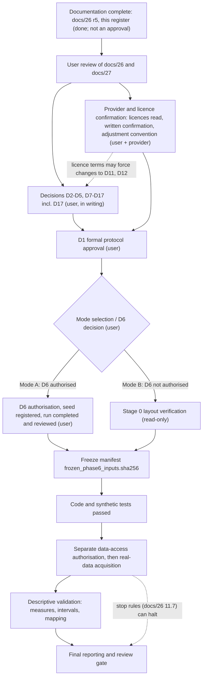

# 27 — QuantLab formal decision and approval register (Phase 6 readiness) — documentation only

**Status:** written 2026-11-13. **Documentation only.** This register records what the project documents say; it approves nothing, authorises nothing and decides nothing. No real market data was accessed or downloaded, no simulation (including D6) was run, no random number was generated, no H1 statistic, rejection rate or critical value was computed, and C3, the frozen specifications, `docs/24`, `docs/25`, `docs/26`, source code, tests, manifests and validation outputs were not touched. Nothing was committed or pushed.

**Evidence labels:** **[RECORDED]** stated in a named project document; **[NOT RECORDED]** looked for and not found; **[NOT SPECIFIED]** the documents do not say. Silence is never treated as approval.

**Sources read for this register:** `docs/26` (revision 5, sections 4, 8.2, 10–14, 16, Appendix B), `docs/03`, `docs/05` (raw-data handling rules), `docs/17c`, `docs/19`, `docs/22b`, `docs/24`, `docs/25`, `docs/README.md`. I searched every file in `docs/` for references to `docs/26` and to "Phase 6": only `docs/26` itself contains them, so **no approval record of any kind for Phase 6 exists** in the repository. (I did not re-read docs 01, 02, 04, 06, 07, 09–16, 17, 17b, 18, 20, 21 in full; they predate the protocol and none was found to record a Phase 6 decision.)

## 1. Purpose and scope
**Purpose.** List every outstanding decision, approval, dependency and authorisation that stands between the current state (a proposed, unapproved protocol) and real-data descriptive validation as defined in `docs/26`. **Scope.** D1–D17 of `docs/26` section 14, the gates they feed, the provider and licence questions, and the order of work. **Not in scope:** deciding any item, choosing a provider or mode, or starting any phase.

**Naming warning.** `docs/22b` also contains decisions called D1–D6 (Stage 4 approvals, approved 2026-11-05, all about Stage 4). They are a different set from the Phase 6 decisions D1–D17 below. `docs/17c` uses "D2" for a different formula confirmation. **The Stage 4 approvals do not approve anything in Phase 6**, and `docs/22b` D6 explicitly conditions Stage 4 on "no real-data descriptive analysis".

**Current recorded position [RECORDED]:** `docs/26` is headed "PROPOSED, not approved, not executed". `docs/24` records that the real-data descriptive placement "was not authorised" and lists whether to authorise it as an open user decision; `docs/19` lists it as blocker B9 ("Not authorised ... Explicit approval of each"). **[NOT RECORDED]**: any later authorisation.

## 2. D1–D17 decision register
Status vocabulary: Approved / Rejected / Pending user decision / Pending external confirmation / Conditional / Not yet evaluated / Blocked by another decision. "Required before": **A** = real-data acquisition, **N** = analysis, **R** = reporting. Every status below is the **current recorded** one; for all 17 decisions the record contains no approval and no rejection.

| ID | Subject (docs/26 §14) | Status | Meaning | Options documented | Evidence for status | Who provides it | Dependencies | Blocks until resolved | Required before |
|---|---|---|---|---|---|---|---|---|---|
| D1 | Approve the protocol (revision 5) and its freeze | **Pending user decision** | Formal acceptance of `docs/26` as the fixed procedure; the freeze manifest `frozen_phase6_inputs.sha256` is created after it | Approve / not approve; recommended default "after your review" | `docs/26` header: not approved; no approval record in `docs/` | The user (the document says "your approval") | Practically follows D2–D17 and mode declaration, because the freeze contains their results (`docs/26` §11.1) | Freeze, E0, every later step | A |
| D2 | Provider, budget, licence sign-off; written confirmation that publishing aggregate descriptive statistics is permitted | **Pending user decision; Pending external confirmation** | Choose the data source and obtain licence confirmation | Recommended default "licensed vendor or institutional access; not Yahoo". Providers discussed: see section 5. No provider chosen | `docs/26` §10: "No provider is confirmed"; NSE side "entirely unconfirmed" | The user (provider, budget, sign-off); the provider (written confirmation) | Licence texts read by the user (§13 E1); adjustment convention verification | Acquisition; D12, D14 wording; Mode B data layout check is separate | A |
| D3 | Universe and per-block index-membership history source | **Pending user decision** | Where NIFTY 50 and S&P 500 membership at each block start comes from | Default "NIFTY 50 and S&P 500 at block start"; the membership **source** is [NOT SPECIFIED] | `docs/26` §4.2 marks it D3/D14 | The user | D14 (acceptability of the source); possibly D2 (licence of that source) [NOT SPECIFIED] | Universe lists; the freeze | A |
| D4 | Span; scheduled-session calendar source | **Pending user decision** | Length of history and the calendar that defines scheduled sessions | Default "at least two years"; calendar source [NOT SPECIFIED] | `docs/26` §4.1 "UNRESOLVED D4" | The user | D2 (what depth the provider offers); D14 | Block definitions, scheduled-session list, freeze | A |
| D5 | Provisional thresholds and conventions (10%, 27%, three panels, 80%, constant 8, ⌈0.9n⌉, 5% rounding, shape multiples, near-tie 1.15, degeneracy limits, day-sd bands, dependence cut points, 0.25/0.75/1.25, jackknife failure thresholds) | **Pending user decision** | Confirm the design constants before freezing; none is statistically validated | Default "as proposed, to be confirmed before freezing" | `docs/26` §14; every item labelled PROVISIONAL | The user | Mode A: fit-noise reference could prompt a numbered new version if shape thresholds change (§13 E2) | Freeze; the mapping | A (must be frozen before access) |
| D6 | Authorise the descriptive reference exercise (cell list, counts, seed 20261216) and thereby select Mode A; declining selects Mode B | **Pending user decision; not authorised** | See section 4 | Authorise (Mode A) or decline (Mode B) | `docs/26` §12 title: "not authorised"; seed 20261216 "not registered until approved" | The user | D1 context; seed registration; Mode declaration in the freeze | Mode A; any coverage label | A (mode is declared before access) |
| D7 | Six exposed stocks | **Pending user decision** | How the six exposed securities are handled | Default "exploratory, never pooled" | `docs/26` §14. What "six exposed stocks" refers to is [NOT SPECIFIED] in the sections I read; I did not locate its definition | The user | [NOT SPECIFIED] | [NOT SPECIFIED] | [NOT SPECIFIED] (before freeze, by §11.1) |
| D8 | Sector information | **Pending user decision** | Whether and how sectors are used | Default "record only" | `docs/26` §14 | The user | D2 (whether provider supplies sectors) [NOT SPECIFIED] | Descriptive included-versus-excluded tables (§4.5 lists sector) | N |
| D9 | Cleaning variants: baseline and strict whole-session; lenient subject to D17 | **Blocked by another decision** (lenient part: D17); baseline/strict parts pending user decision | Which cleaning variants are run | Default "baseline and strict as proposed" | `docs/26` §14, §7.3: lenient clauses provisional until D17 | The user | D17 | Variant definitions in the freeze | A (freeze) |
| D10 | Report all panels and blocks; counts of labels only | **Pending user decision** | Reporting scope | Default "yes" | `docs/26` §14 | The user | None recorded | Final report format | R |
| D11 | Aggregate outputs allowed in the repository | **Pending user decision** | What may be stored in `outputs/` | Default "aggregates only"; `docs/05` and `docs/26` §11.8 say raw data stay outside the repository | `docs/26` §14, §11.8 | The user | D2 (licence may restrict storage or aggregates) | Writing any output | N |
| D12 | Security identifiers in reports | **Pending user decision; Blocked by D2** | Whether tickers appear | Default "per licence" | `docs/26` §14 | The user, after D2 | D2 | Report content | R |
| D13 | Stop rules (§11.7) | **Pending user decision** | Conditions that halt the phase | Default "as proposed" | `docs/26` §14, §11.7 | The user | None recorded | Freeze | A |
| D14 | Acceptability of calendar and index-membership sources | **Pending user decision** | Whether the sources chosen under D3/D4 are acceptable | Default "user to confirm" | `docs/26` §14 | The user | D3, D4 | Freeze | A |
| D15 | The unequal-group jackknife estimator (weights, equal 1/g convention) and tests T1–T6 | **Pending user decision** | Approve the interval estimator | "approve, or specify another estimator" | `docs/26` §7.2, Appendix C (algebraic checks done in scratch scripts; not a validation on data) | The user | None | Interval and reliability measures | N |
| D16 | Outcome-free feed and liquidity characteristics for the included-versus-excluded comparison (§4.5) | **Pending user decision** | List of characteristics | Default "as proposed" | `docs/26` §14, §4.5 | The user | D8 (sector) in part | Feed-quality tables | N |
| D17 | Lenient-variant conflict (7.3 versus 4.5, 4.1, 8.1) | **Pending user decision** (flagged UNRESOLVED by the protocol) | Resolve a contradiction in the protocol | (i) drop lenient; (ii) keep as exploratory report on panels incomplete only by up to two used slots, amending 4.5 and 8.4; (iii) another specification. No recommendation | `docs/26` §14, Appendix B | The user | Feeds D9 | Lenient clauses of 7.3 and 8.4 stay provisional; D9; freeze. Option (ii) would change `docs/26`, so it needs a numbered new revision | A (before freeze) |

**Counts (all 17 decisions):** Approved **0**; Rejected **0**; Pending user decision **17** (all). Of these, additionally **Pending external confirmation: 1 (D2, with D12 inheriting it)**; **Blocked by another decision: 2 (D9 by D17, D12 by D2)**; **Conditional: 0 recorded** (D1 is practically conditional on the others, but the document does not say so as a rule); **Not yet evaluated: 0** (every one has a default or an option text). Decisions with unspecified details: D3, D4, D7, D8, D14 (see "[NOT SPECIFIED]" entries).

## 3. Critical approval gates (minimum before real-data validation)
No gate below is satisfied on the record. Approval of one gate does not grant another (`docs/26` §1 and §13: data access is a **separate, explicit authorisation**).

| Gate | What must exist | Status |
|---|---|---|
| G1 Protocol approval | D1 plus D2–D5, D7–D17 decided in writing, including D17 | **Not met** |
| G2 Reference-mode declaration | Mode A or Mode B declared in the freeze manifest; cannot change later without a numbered new protocol version (`docs/26` §8.2) | **Not met** |
| G3 D6 authorisation (only if Mode A) | Explicit authorisation, registered seed, completed run | **Not met; not authorised** |
| G4 Provider/licence confirmation | See section 5 | **Not met** |
| G5 Adjustment convention verification from the provider's documents (`docs/26` §13 E1) | Verified in writing | **Not met** |
| G6 Freeze manifest | `frozen_phase6_inputs.sha256` listing protocol, scheduled-session list, universe lists and sources, calendar, thresholds, reference mode and reference file hashes, code (`docs/26` §11.1) | **Not created** |
| G7 Tests on synthetic inputs | Mapping tests of 8.10, jackknife checks T1–T6, DST and exclusion tests passed before any data access (`docs/26` §8.10, §11.6) | **Not written** (writing code needs authorisation; `docs/26` §13 E3 is not authorised) |
| G8 Separate data-access authorisation | Written, explicit | **Not given** |

**Before any real-data download** the documents require: G1–G8, plus raw data stored outside the repository, write-once with SHA-256 (`docs/05` rules; `docs/26` §11.2, §11.8), and no data fetched before the manifest exists (§11.1). **Frozen first:** the protocol, scheduled-session list, universe lists and their sources, calendar, thresholds, the declared mode and its reference file hashes, and the code (§11.1). **Handling restrictions:** raw data not in the repository; cleaned data in separate files recording the raw hash; only aggregates in `outputs/` (D11 pending); no pooling across providers; each measurement computed once per block and variant; no H1 statistic on real data; no rule change after seeing data (stop rule).

## 4. D6 and Mode A / Mode B
**Is D6 approved?** No. **Pending user decision; not authorised** (`docs/26` §12, §14). **Proposed simulations [RECORDED, all proposed, none run]:** tail reference 320 cells × 2,000 world-draws (Student-t df 3,4,5,6,8,10,20,∞; NSE/US; 3 stocks; n 59,90,125,180,250; shape flat/E; day-factor sd 0.3/0.6); Laplace reference 40 cells × 2,000; fit-noise reference 60 cells × 1,000; proposed master seed 20261216 (not registered; 20261201–20261213 and 20261215 are in use). D6 is a descriptive reference exercise: it never computes T, never loads C3 values, never adds a validated point, and is not added to the calibration ledger (8,024,000).

| | **Mode A** | **Mode B** |
|---|---|---|
| Activated when | D6 **authorised and completed** (all cells finished, quantiles computed, files hashed) | D6 **not authorised**. A partially completed D6 is neither mode |
| Reference | Frozen D6 set; four-variant envelopes (shape × day-factor sd) | Existing Stage 0 file `reference_known_df_distribution.csv`, single variant, 200 reps per df, day-sd 0.3 only |
| D-tail | All five n | Only n = 59; otherwise U (D-TAIL-NO-REFERENCE) |
| Laplace | Evaluated | LAPLACE-UNEVALUATED |
| Alternative feature (d), D-alt | Evaluated | **Always U** (no per-stock reference) |
| Fit-noise check of shape thresholds | Available | None; SHAPE-THRESHOLDS-UNCHECKED |
| Possible outcomes | REPRESENTED, NEAR BOUNDARY, PARTIALLY REPRESENTED, OUTSIDE, CANNOT BE CLASSIFIED | **Only OUTSIDE or CANNOT BE CLASSIFIED** (no coverage rank) |

**Prohibited while D6 is unauthorised:** running any D6 world-draw; registering seed 20261216 as used; describing the Stage 0 file as equivalent to D6 or as an envelope; any substitute, proxy or workaround reference for the missing Mode B parts (`docs/26` §8.2); and, as always, any use of D6 to compute T or touch C3.

**What would permit Mode A.** The documents say D6 requires separate authorisation "with registered seed" (§14 default). The **exact wording** of an authorisation, and **who may give it**, are **[NOT SPECIFIED]** beyond "the user". A reasonable record would name the cell list, the counts, the seed and the folder, but that is my suggestion, not a documented rule. Mode A also needs the completed run reviewed and, if thresholds change, a numbered new protocol version (§13 E2).

**Conditions for selecting Mode B.** D6 declined or not authorised; and the open verification: **whether the Stage 0 worlds' layout equals the validated 59-session layout of each market** (`docs/26` §8.2, §13 E2, §16). `docs/14` §6 is said to describe the worlds as following the real sample's layout of about 59–60 days; this has **not** been confirmed from `docs/14` and the Stage 0 script. **Yes, the Stage 0 layout is still an outstanding verification dependency for Mode B.** It is read-only, and I did not do it in this task.

**Never infer from Mode B results:** a coverage label (REPRESENTED, NEAR BOUNDARY or PARTIALLY REPRESENTED); that the Stage 0 file is the D6 envelope; that any block is "within the validated domain"; that C3 holds any rate on the data; that missing references mean "no problem". Mode B reports are descriptive measurement and data-quality reports without placement.

## 5. Provider and licensing confirmation register
Source: `docs/26` §10 (pages read 2026-11-12; no account created, no data fetched) and `docs/03` (research of 2026-10-30, partly unverified). **No provider is confirmed.**

| Provider | What is recorded | Open questions (all unresolved) |
|---|---|---|
| Databento | Usage-based pricing; redistribution depends on dataset and publisher; "most datasets" redistributable after 24 hours; licence-fee tiers listed [PRIMARY-READ] | US-equity OHLCV-1m availability not confirmed [LEAD]; derived-statistics rights need the dataset licence; which tier applies |
| Massive (Polygon) | Minute aggregates in select plans, depth by plan; "all U.S. equities" [PRIMARY-READ] | Consolidated or not: not stated; terms of service not read [LEAD] |
| TrueData (NSE) | Licensed not owned; internal analysis permitted; redistribution, resale or public sharing needs prior written permission; storage not stated; price by sales quote; statements on exchange fees conflict [PRIMARY-READ] | Whether publishing aggregate results is "redistribution"; storage rights; NSE history depth; price |
| NSE Data & Analytics | Historical-data products and data-sharing policy [LEAD] | **Both NSE PDFs timed out twice and were not read**; terms entirely unread |
| WRDS / NYSE TAQ | Institutional access; indicators [LEAD] | Coverage, access, licence not stated on the page read |
| Zerodha, Upstox, Angel One, Alpaca (IEX only) | From `docs/03` (2026-10-30), not re-read [LEAD] | Storage and derived-work rights not checked; Alpaca Basic is IEX-only |
| Yahoo Finance (yfinance) | About 60 days of 5-minute bars, revised, personal use only; no redistribution (`docs/03`, `docs/26`) | Recorded as not suitable (`docs/26` recommended default "not Yahoo"); a formal exclusion decision is part of D2 |

**Questions that must be answered before acquiring or processing real data:** (1) which provider (D2); (2) written confirmation that **storing** the data and **publishing aggregate descriptive statistics** are permitted; (3) whether security identifiers may appear in reports (D12); (4) NSE terms read at all; (5) adjustment convention (splits, dividends, bar construction, IEX-only versus consolidated) verified from the provider's documents; (6) whether all five sample sizes, including 250 sessions, are obtainable for NSE and the US on the chosen provider; (7) whether delisted securities can be characterised; (8) handling of NSE session-hour changes and the closing-window quirk. The documents specify that the **user** reads the licence text (§10, §13 E1). Who gives written provider confirmation is the provider; the form of confirmation is **[NOT SPECIFIED]**. Results are not pooled across providers.

## 6. Dependency flowchart
Arrows mean "must be completed before the next box can start". No box grants another: each approval is separate.

The order of D1 against the other decisions is not rigid in `docs/26` (E0 groups protocol approval, D1–D17 and the mode declaration); the diagram shows the dependency that the freeze needs the decided contents.

## 7. Ordered execution checklist
**A. Can proceed now (no new authorisation; none done in this task unless stated).**

| # | Action | Evidence needed | Completion condition |
|---|---|---|---|
| 1 | User reads `docs/26` r5 and this register | User's written feedback | Review recorded (by the user) |
| 2 | Read `docs/14` §6 and the Stage 0 script to verify the Stage 0 layout equals the validated 59-session layout (matters only for Mode B) | Quoted lines and a conclusion in a note | Equality confirmed or refuted in writing. **Not done**; read-only files, still an unstarted task |
| 3 | User reads provider licence texts, including the two NSE PDFs that failed to load | Licence text, retrieval date | Per-provider notes of storage, derived-work, redistribution and publication terms. Only the user can do this per `docs/26` |

**B. Requires explicit user decision or authorisation.**

| # | Action | Evidence needed | Completion condition | Status |
|---|---|---|---|---|
| 4 | Decide D17, then D9 | Written decision | Choice (i), (ii) or (iii) recorded; if (ii) or (iii) a numbered new `docs/26` revision | **Wait** |
| 5 | Decide D3, D4, D5, D7, D8, D10, D11, D13, D14, D15, D16 | Written approval record | Each decision recorded (a record file is not yet created) | **Wait** |
| 6 | Provider choice, budget and written confirmation (D2) | Provider's written confirmation covering storage and aggregate publication; decision on identifiers (D12) | Confirmation filed; D12 decided | **Wait** (needs 3) |
| 7 | Verify adjustment convention from provider documents | Quoted provider documentation | Written verification | **Wait** (needs 6) |
| 8 | D1: approve the protocol revision | Written approval of a specific revision | Approval record naming the revision | **Wait** |
| 9 | Declare the reference mode / decide D6 | Written mode declaration | A or B named | **Wait** |
| 10 | Mode A only: authorise D6, register seed, run it, review envelopes and fit-noise, issue a numbered version if thresholds change | Authorisation text, seed registry entry, hashed outputs | All cells finished, quantiles computed, files hashed | **Wait**; not authorised |
| 11 | Mode B only: complete item 2 | As item 2 | Layout confirmed | **Wait** for the mode declaration |
| 12 | Write and test code on synthetic data (8.10, T1–T6, DST, exclusions) | Passing test record | All pass before any data access | **Wait**; code changes not authorised |
| 13 | Create the freeze manifest | Manifest hashes | File exists before any fetch | **Wait** (needs 4–12) |
| 14 | Separate data-access authorisation | Written authorisation | Given | **Wait** |
| 15 | Acquire daily reference data, then 5-minute data; hash raw files | Raw hashes, outside the repository | Write-once files with SHA-256 | **Wait** (needs 14) |
| 16 | Quality control, feed-quality tables, universe ledger | Ledgers | Complete | **Wait** |
| 17 | Compute measures, intervals; apply the mapping | Output files | Run once per block and variant | **Wait** |
| 18 | Report and review gate | Report from saved files | Review recorded. H1 testing on real data needs a new authorisation | **Wait** |

## 8. Work currently blocked
Everything in B above is blocked. Specifically: **real-data access or download** (G1–G8 unmet); **D6 simulations and Mode A**; **writing production or test code for Phase 6**; **creating the freeze manifest**; **any coverage label**; **the lenient variant** (D17); **security identifiers in reports** (D2); **any commit or push** of this work (not authorised; `docs/19` B11). Also outside Phase 6 and still unauthorised: the research protocol (`docs/07`), H2, H3, M5, real-market H1 tests, candidate revisions (`docs/19` B5, B9).

## 9. Decisions requiring the user's direct approval
D1–D17 (all, individually); the declaration of Mode A or B (via D6); the **separate data-access authorisation**; authorisation and seed registration for D6 if Mode A; the user's own reading of provider licences; and, outside Phase 6, whether to commit and push the untracked Stage 2–6 work and choose a licence (`docs/19` B11). I have not recorded any of these as given.

## 10. Final readiness assessment
**Not ready for real-data work.** Of 17 decisions none is approved; the protocol itself is unapproved; no provider or licence is confirmed (NSE terms are entirely unread); the reference mode is undeclared and D6 is unauthorised; the Stage 0 layout check for Mode B is outstanding; D17 identifies an internal conflict that needs a user decision (and possibly a new revision); no freeze manifest or Phase 6 tests exist; and no data-access authorisation has been given. **Real-data work is not authorised.** The documentation phase is complete in the sense that the decisions are fully listed; it is not an approval of anything. Items marked [NOT SPECIFIED] (D3/D4 source choices, the D7 definition, the form of provider confirmation, who may authorise D6 beyond "the user") are missing from the documents, not guessed here.
