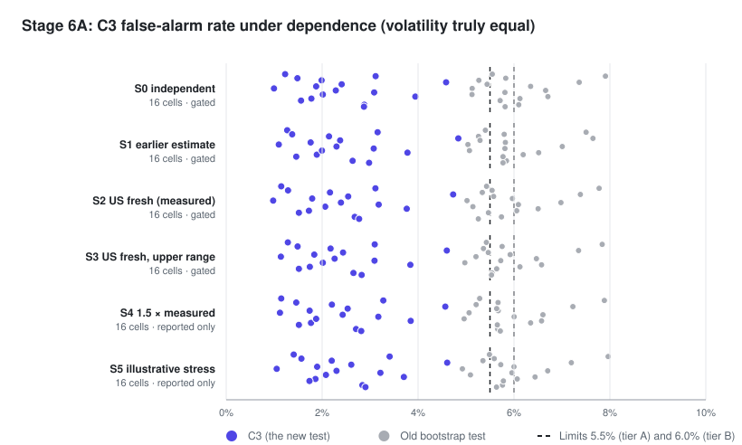
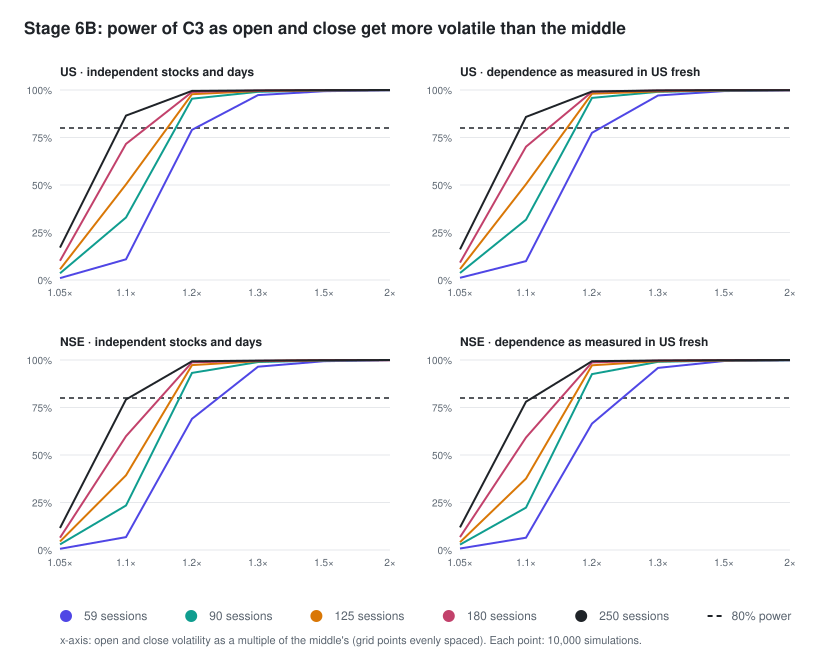
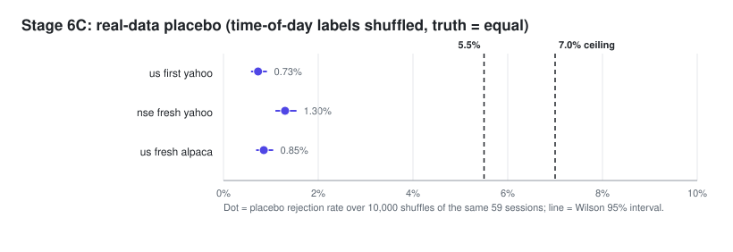

# 43: Stage 6 report: dependence stress test, power curve and real-data placebo

**Status: final, generated from the saved result files by `scripts/milestone4/stage6_make_report.py`. The design, gates and the interpretation of each outcome were fixed in [docs/42](42_stage6_preregistration_dependence_power_placebo.md) before any run.** Parts A and B are simulated data only; Part C re-used the three real samples already tested (no new data). C3 was applied unchanged; no earlier frozen file was touched.

## 1. Summary

- **Part A (dependence stress test): STRESS_PASS.** Highest C3 false-alarm rate on the 64 gated cells: 4.84% (limits 5.5% and 6.0%).
- **Part B (power):** see the tables in section 3 for the smallest difference detected at 59, 90, 125, 180 and 250 sessions.
- **Part C (real-data placebo):** us_first_yahoo 0.73%; nse_fresh_yahoo 1.30%; us_fresh_alpaca 0.85% (limit 5.5%).

## 2. Part A: is C3 still safe when stocks and days are dependent?

**Run:** 96 cells × 25,000 simulations = 2,400,000; master seed 20261401; wall time 47.4 minutes. Volatility was truly equal in every cell, so every rejection is a false alarm. A gated cell passes when C3's rate is at most 5.5% (tier A, tail T6) or 6.0% (tier B, tail T4).

**Outcome label: STRESS_PASS.** Of 64 gated cells: 64 PASS, 0 PASS_AMBIGUOUS, 0 FAIL_AMBIGUOUS, 0 FAIL. Highest gated C3 rate: **4.84%**; highest rate at the ungated levels: 4.61%.

### By dependence level

| Level | ret_corr / share / phi | Role | Cells | PASS | PASS_AMBIG. | FAIL_AMBIG. | FAIL | Highest C3 rate | Median C3 rate | Old test, highest |
|---|---|---|---:|---:|---:|---:|---:|---|---|---|
| S0 independent | 0.0 / 0.0 / 0.0 | gated | 16 | 16 | 0 | 0 | 0 | 4.58% | 2.15% | 7.91% |
| S1 earlier estimate | market-specific (NSE 0.355 / 0.454 / 0.441, US 0.187 / 0.141 / 0.190) | gated | 16 | 16 | 0 | 0 | 0 | 4.84% | 2.22% | 7.65% |
| S2 US fresh, measured | 0.24 / 0.3 / 0.42 | gated | 16 | 16 | 0 | 0 | 0 | 4.73% | 2.28% | 7.78% |
| S3 US fresh, upper range | 0.29 / 0.5 / 0.61 | gated | 16 | 16 | 0 | 0 | 0 | 4.60% | 2.22% | 7.84% |
| S4 1.5 × measured | 0.36 / 0.45 / 0.63 | reported only | 16 | 16 | 0 | 0 | 0 | 4.57% | 2.32% | 7.88% |
| S5 illustrative stress | 0.5 / 0.7 / 0.7 | reported only | 16 | 16 | 0 | 0 | 0 | 4.61% | 2.25% | 7.96% |

### Highest C3 rates in the whole grid

| Market | Shape | Tail | Sessions | Level | Role | C3 rate | Wilson 95% | Limit |
|---|---|---|---|---|---|---|---|---|
| NSE | E | T4 | 125 | S1 earlier estimate | gated | 4.84% | [4.58%, 5.11%] | 6.0% |
| NSE | E | T4 | 125 | S2 US fresh, measured | gated | 4.73% | [4.48%, 5.00%] | 6.0% |
| NSE | E | T4 | 125 | S5 illustrative stress | reported | 4.61% | [4.36%, 4.87%] | 6.0% |
| NSE | E | T4 | 125 | S3 US fresh, upper range | gated | 4.60% | [4.35%, 4.87%] | 6.0% |
| NSE | E | T4 | 125 | S0 independent | gated | 4.58% | [4.33%, 4.85%] | 6.0% |
| NSE | E | T4 | 125 | S4 1.5 × measured | reported | 4.57% | [4.32%, 4.83%] | 6.0% |

### By sample size (gated cells)

| Sessions | Gated cells | Highest C3 rate | Median C3 rate |
|---|---|---|---|
| 59 | 32 | 3.16% | 1.64% |
| 125 | 32 | 4.84% | 2.80% |

### Reading (committed in docs/42 before the run)

**STRESS_PASS.** C3 stayed within its limits at the dependence levels measured in real data, including their upper uncertainty range, in the cells tested. This is not a claim of validity everywhere.

At the two ungated stress levels (S4, S5) C3 stayed within the limits in all 32 cells; the highest rate was 4.61%. That is the edge of what was tried, not a guarantee beyond it.

For reference, the old bootstrap test on the same datasets had a highest rate of 7.96% and a median of 5.77%; it gates nothing.

## 3. Part B: how big a difference can C3 detect?

**Run:** 120 cells × 10,000 simulations; master seed 20261402; shape R2, tail T4 (heavy), open and close volatility = multiplier × the middle's. Power = share of simulations in which C3 rejects. Nothing is gated.

### US, independent stocks and days

| Sessions | 1.05× | 1.1× | 1.2× | 1.3× | 1.5× | 2× | Smallest multiplier with 80% power |
|---|---|---|---|---|---|---|---|
| 59 | 1.0% | 10.9% | 79.1% | 97.3% | 99.4% | 99.8% | 1.20× |
| 90 | 3.5% | 32.9% | 95.4% | 99.1% | 99.8% | 100.0% | 1.17× |
| 125 | 5.6% | 50.3% | 97.8% | 99.5% | 99.8% | 99.9% | 1.16× |
| 180 | 10.1% | 71.6% | 99.0% | 99.7% | 99.9% | 100.0% | 1.13× |
| 250 | 17.1% | 86.5% | 99.5% | 99.8% | 99.9% | 100.0% | 1.10× |

### US, dependence as measured in the US fresh sample

| Sessions | 1.05× | 1.1× | 1.2× | 1.3× | 1.5× | 2× | Smallest multiplier with 80% power |
|---|---|---|---|---|---|---|---|
| 59 | 1.1% | 10.0% | 77.5% | 97.1% | 99.4% | 99.8% | 1.21× |
| 90 | 3.7% | 31.7% | 95.8% | 99.0% | 99.6% | 100.0% | 1.17× |
| 125 | 5.8% | 50.4% | 98.1% | 99.3% | 99.8% | 100.0% | 1.16× |
| 180 | 9.2% | 70.2% | 99.0% | 99.7% | 99.9% | 100.0% | 1.13× |
| 250 | 16.1% | 85.9% | 99.2% | 99.8% | 100.0% | 100.0% | 1.10× |

### NSE, independent stocks and days

| Sessions | 1.05× | 1.1× | 1.2× | 1.3× | 1.5× | 2× | Smallest multiplier with 80% power |
|---|---|---|---|---|---|---|---|
| 59 | 0.6% | 6.8% | 69.1% | 96.5% | 99.4% | 99.9% | 1.24× |
| 90 | 2.9% | 23.4% | 93.2% | 99.0% | 99.7% | 100.0% | 1.18× |
| 125 | 4.5% | 39.3% | 97.3% | 99.4% | 99.9% | 100.0% | 1.17× |
| 180 | 6.5% | 59.9% | 98.8% | 99.5% | 99.9% | 100.0% | 1.15× |
| 250 | 11.6% | 79.2% | 99.3% | 99.7% | 99.9% | 100.0% | 1.10× |

### NSE, dependence as measured in the US fresh sample

| Sessions | 1.05× | 1.1× | 1.2× | 1.3× | 1.5× | 2× | Smallest multiplier with 80% power |
|---|---|---|---|---|---|---|---|
| 59 | 0.8% | 6.5% | 66.5% | 95.9% | 99.5% | 99.8% | 1.24× |
| 90 | 2.8% | 22.3% | 92.6% | 99.1% | 99.7% | 99.9% | 1.18× |
| 125 | 4.1% | 37.6% | 97.2% | 99.4% | 99.8% | 100.0% | 1.17× |
| 180 | 6.8% | 59.2% | 98.7% | 99.7% | 99.9% | 100.0% | 1.15× |
| 250 | 11.9% | 78.0% | 99.4% | 99.8% | 99.9% | 100.0% | 1.11× |

### Reading

- With 59 sessions the smallest open/close multiplier C3 detects with 80% power is 1.20× to 1.24× across the four settings above; with 250 sessions it is 1.10× to 1.11×.

- At a multiplier of 2.0× (the real samples showed open/middle ≈ 1.95–2.17×), the lowest power anywhere in the grid is **99.8%**, so a difference of the observed size is found almost every time, including under the stronger dependence.

- Smaller real differences (1.05×–1.2×) are often missed at 59 sessions: C3 is cautious, and a 'not rejected' result there is weak evidence of equality, never proof of it.

- Power values come from simulated markets with the stated shape and tail; real markets may differ.

## 4. Part C: does C3 behave on real data's own structure?

**Run:** each tested real sample's 59 sessions, time-of-day labels shuffled in every session (same shuffle for all three stocks), 10,000 shuffles per sample, master seed 20261403, C3 limit 3.2987. The truth is 'equal' by construction, so every rejection is a false alarm. The rebuilt data reproduced each recorded real T exactly.

| Sample | Real T | Placebo rejection rate | Wilson 95% | Median placebo T | 95th percentile of placebo T | Largest placebo T | Label |
|---|---:|---|---|---|---|---|---|
| us_first_yahoo | 22.59 | 0.73% | [0.58%, 0.92%] | 1.14 | 2.51 | 4.90 | PLACEBO_OK |
| nse_fresh_yahoo | 17.31 | 1.30% | [1.10%, 1.54%] | 1.23 | 2.63 | 5.72 | PLACEBO_OK |
| us_fresh_alpaca | 17.75 | 0.85% | [0.69%, 1.05%] | 1.19 | 2.57 | 4.73 | PLACEBO_OK |

Not computed: nse_first_yahoo (not testable under the frozen rule (docs/30 R1); no placebo computed).

### Reading (committed in docs/42 before the run)

- Labels: OK means the placebo rate is at most 5.5%; WARN means 5.5% to 7.0%; HIGH means above 7.0%. Result: us_first_yahoo PLACEBO_OK, nse_fresh_yahoo PLACEBO_OK, us_fresh_alpaca PLACEBO_OK.

- The highest placebo rate was 1.30%; every real T is far above its placebo 95th percentile (largest placebo T of any sample: 5.72 against real values of 17.31 to 22.59), so the real rejections are not explained by fat tails or dependence alone.

- Limits: the shuffle also breaks the within-day pattern of volatility, so this is a stress check, not a proof of size; the shuffles reuse the same 59 sessions, so they describe C3 on these sessions rather than on all possible days; and it does not test power.

## 5. What this changes, and what it does not

- It adds evidence about C3's behaviour at the dependence levels that Phase 6 found in the fresh US data (Part A), a measured answer to 'is C3 too cautious?' (Part B) and a check on real structure (Part C).

- It does **not** prove C3's false-alarm rate on real markets, does not add independent stocks (that needs a new data pull, see [docs/44](44_independent_holdout_design.md)), and makes no claim about trading or profit.

- C3's verdict stays PARTIAL unless the owner decides otherwise after reading this report; Stage 6 does not change it by itself.

## 6. Files

`outputs/milestone4/stage6/part_a/` (96 per-cell result files, `size_by_cell.csv`, `part_a_outcome.csv`), `part_b/` (`power_by_cell.csv`, `min_detectable_effect.csv`), `part_c/` (`placebo_results.csv`), run logs, and `scripts/make_stage6_charts.py` for the charts.
